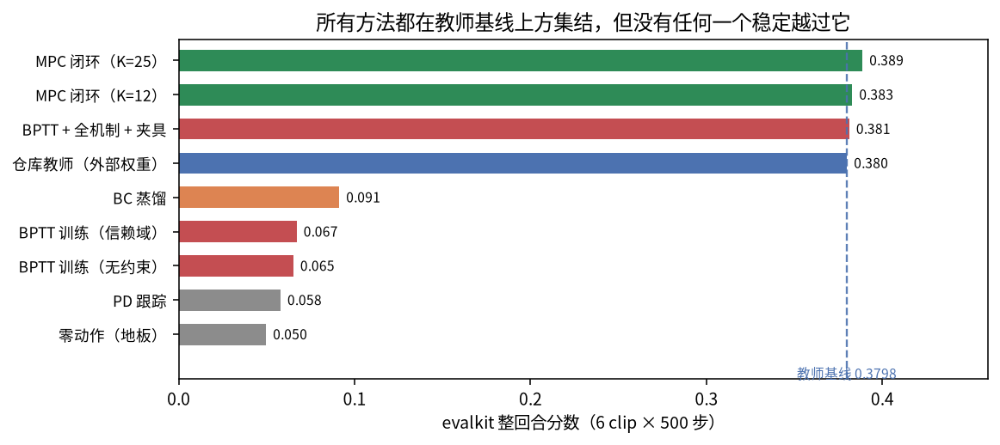
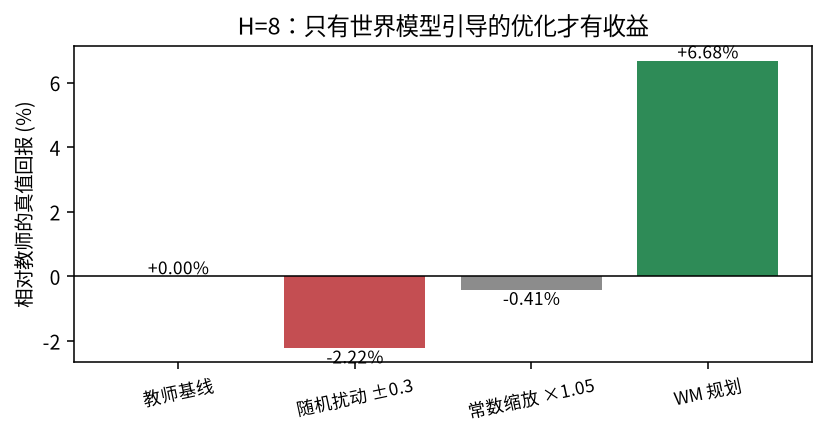
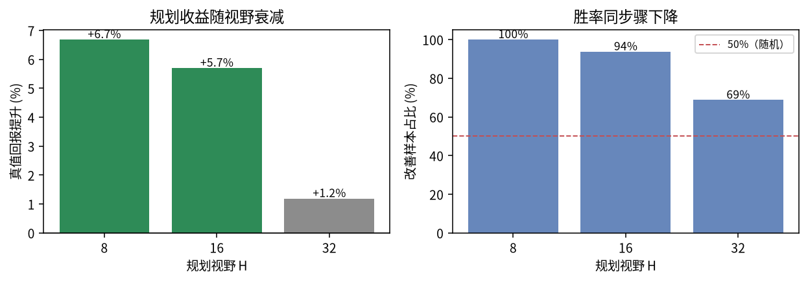
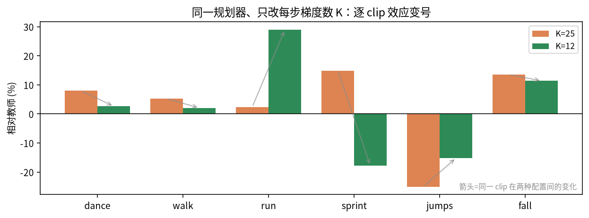
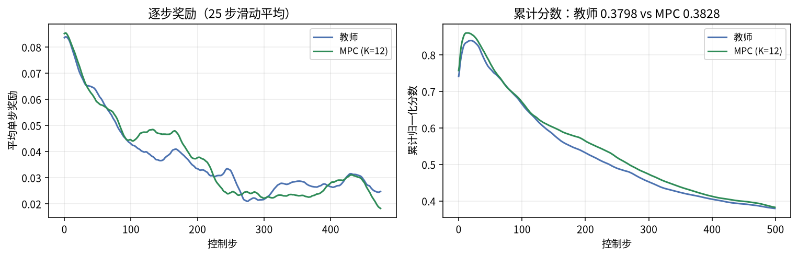

# SuperMimic-mini

在两张消费级显卡上拆开验证 [SuperMimic](https://arxiv.org/abs/2610.28480)（CoRL 2026 Oral）的核心机制：**用一个可微世界模型替代刚体仿真器，再用短视野 BPTT 把梯度直接传回策略**。对象是 Unitree G1（29 DoF），任务是在 LAFAN1 动作上做全身跟踪。

> **一句话结论**
> 机制本身是真的——世界模型能学会动作、梯度方向正确、用它规划单个窗口有 **+6.7%** 的真值收益。
> 但**这两条路都没能在整回合评测上稳定超过一个现成策略**：训练路线 **−80% ~ ≈0**，规划路线 **+0.8%** 且随超参变号。
> 原因不是跑得不够久，而是**算力 → 精度 → 机制**这条链上有五道精度检查，我们只跨过了前两道。



上图的读法很直接：**除了教师本身，所有方法都挤在 0.05–0.09（失败区）或 0.38（基线附近）两处**。
中间没有任何东西——这正是"机制能看见，但用不出来"的样子。

---

## 一、机制是成立的（三条独立证据）

| 检查 | 阶段一（6 GB） | 阶段二（16 GB） | 说明 |
|---|---|---|---|
| 动作条件化 `capture` | 7.5% | **81%** | 世界模型从"看不见动作"到"能复现动作效应" |
| 动作梯度符号一致率 | ≈0 | **96.2%** | Pearson +0.622，p=1e-35；梯度方向可信 |
| 短视野规划收益 | — | **+6.68%**（H=8） | 真值仿真器实测，胜率 **100%**，p=3.7e-12 |

第三行需要特别说明：我们把规划锚定在**教师自己的动作**上，并做了两个对照以排除伪影——



**随机扰动在同样幅度下是 −2.22%，常数缩放 ±0.4%，只有世界模型引导的优化才有 +6.68%。** 所以这个正信号是真的。

---

## 二、但它有一个明确的视野上限



收益从 **+6.68%（H=8）** 衰减到 **+5.70%（H=16）**、再到 **+1.19%（H=32，p=0.26 不显著）**，胜率同步从 100% 掉到 69%。

原因不神秘：世界模型的 on-policy 32 步误差只比"状态不动"好 2 倍（`ratio32 ≈ 0.50`）。**模型在 8 步内可信，在 32 步内不可信。**

---

## 三、用这个模型训练策略：全线失败

我们用零蒸馏误差的**教师权重本身**做底座（排除"底座太弱"这个混杂），把论文里缺的机制逐一补上：

| 配置 | 分数 | 相对教师 | 说明 |
|---|---|---|---|
| 旧实现（无保护） | 0.1645 | **−56.7%** | 崩塌 |
| + 可微 bootstrap（∇θ 穿过 γ^H·V） | 0.0679 | **−82.1%** | 反而更差：critic 的 ∂V/∂s 是噪声 |
| + survival weight + critic 20 步更新 | 0.1083 | −71.5% | 软终止几乎不激活（d̄≈0.02） |
| + 动作夹具 0.2 | 0.3725 | −1.9% | **唯一能止崩的** |
| + BC 软正则 | 0.3780 | −0.5% | 同上 |
| + 交错在线循环 | 0.3689 | −2.9% | 无改善 |
| + critic 预热 | 0.3811 | +0.4% | 与零无异（p=0.81） |

**结论：崩溃是方向性的，不是"学得慢"。** 崩塌发生在 10–20 轮内；把模型精度提升 3.2× 只把伤害从 −80% 挪到 −69%；而把视野从 16 缩到 4 完全无效（仍 −82%）。

**三个"缺失的机制"装回去仍然无效**——它们不是修复项，而是**精度的放大器**：在低精度下放大的是噪声。

---

## 四、用这个模型规划：局部有效，整回合归零

把规划接入闭环（每步重规划、只执行首个动作），与教师同台评测 6 条 clip × 500 步：

| 配置 | 均值 | 相对教师 | 存活 |
|---|---|---|---|
| K=25（每步 25 次梯度） | 0.3886 | +2.32% | 389 |
| **K=12** | **0.3828** | **+0.79%** | **431（= 教师 430）** |

降 K 修好了 jumps 的灾难性失败（存活 250 → 500），代价是收益归零。而更关键的是：



**同一个规划器，只把每步梯度数从 25 改成 12，逐 clip 效应就变号**（sprint 从 +14.8% 翻到 −17.8%，run 从 +2.4% 到 +29.0%），平均差 **13.3pp**、最大 **32.6pp**。

这不是采样噪声——评测是**确定性**的（CLEAN 配置关闭全部噪声，教师连跑两次分数逐位相同）。这是**超参敏感性**：噪声能靠加种子消除，超参敏感不能。



**逐步看，两者反复交叉、互有进出**：MPC 在 100–200 步领先（单步 0.048 vs 0.042），教师在中段追回，最后又交错。
累计分数（右图）也从早期的"MPC 略高"逐渐收敛到终值 0.380 vs 0.383。

> **所以规划路线的结论是：局部 +6.7% 是真的，但它不能转化为整回合收益。** 闭环下每步扰动会改变后续状态分布，
> 30 秒后轨迹已完全不同于教师走过的路径，局部改进被重新分布掉了——**过程看起来像在改善，结果是平手**。

---

## 五、算力是如何起作用的

不是"跑得不够久"。差的是**数据生成**，而数据生成取决于有没有 GPU 物理仿真：

| | 论文（H100 80 GB） | 本机（16 GB，无 CUDA） |
|---|---|---|
| 想象样本总量 | 4.19×10¹⁰ | 6.1×10⁴（**68 万倍差距**） |
| 世界模型梯度步 | 3,200,000 | 100,000（32×） |
| 策略迭代 | 320,000 | 60 |
| 并行环境 | 4096 / GPU | 64（CPU 多进程） |
| 数据 | BONES-SEED 129,514 条 | LAFAN1 40 条 |

**关键证据**：我们的的世界模型精度在 100k 梯度步后**卡住不再下降**（`NSE32`：4.51 → 1.39 → 1.02 → 1.15 → 1.04）。再给梯度步没用——**受限的是数据覆盖**。

于是得到五道精度检查：

| # | 检查 | 阈值 | 本机 | |
|---|---|---|---|---|
| 1 | 动作条件化 | ≫0 | 81% | ✅ |
| 2 | 梯度符号一致率 | >90% | 96.2% | ✅ |
| 3 | 开环精度 NSE32/persistence | <0.2 | 0.50 | ❌ |
| 4 | 动作幅度偏置 mag_ratio | <1.5 | 4.1 | ❌ |
| 5 | critic 精度（支撑 γ^H·V） | 雅可比可信 | 未达标 | ❌ |

**需要什么级别的算力**（已知 4090 24 GB 可行，据此上下推）：

| 档位 | 判定 |
|---|---|
| 6 GB CUDA（2060） | ✗ 捕获率仅 7.5% |
| **16 GB 无 CUDA（本机）** | **✗ 机制可验证，端到端不行** |
| 16 GB CUDA | △ 推测可行，未验证 |
| **24 GB CUDA（4090）** | ✓ 已知可行，约 10–12 h |
| 40–80 GB | ✓✓ 论文级 |

> 换一张 **24 GB 的 N 卡，比换一张 40 GB 的 A 卡更关键**——前者跨过的是"有没有 GPU 物理"这道坎，后者只是把 batch 再放大。显存从来不是瓶颈：我们跑论文同款 2048³ 模型，AC 只占 **3.6 / 16 GB**。

---

## 六、三个阶段的样子

| | 阶段一（RTX 2060 6 GB） | 阶段二（RX 6800 XT 16 GB） | 阶段三（规划型 BPTT） |
|---|---|---|---|
| 要回答 | 链路跑得通吗 | 瓶颈在哪 | 规划能否超过教师 |
| 结果 | 通，但捕获率 7.5% | 捕获 81%，训练无效 | 局部 +6.7%，整回合 +0.8% |


*阶段一：从零训练的 WM+BPTT 策略在 LAFAN1 Sprint 上跟踪（左策略，右参考）*


*阶段二：五格同步对比（参考 / 教师 / BC / BPTT / PD）——只有教师能跑满*


*阶段三：三格对比（参考 / 教师 / MPC）*

更多视频见 [docs/demo/README.md](docs/demo/README.md)。

---

## 七、对复现研究的四条启示

1. **"能不能复现"不是算力够不够的连续问题，而是一串离散的精度门槛。** 跨不过第 3 道，后面所有机制都会失效——加多少迭代都没用。
2. **机制不是可插拔的。** 论文的可微 bootstrap / survival weight / 在线循环是配套精度设计的；在小预算下单独搬过来，**效果是负的**（−57% → −82%）。
3. **评测协议决定结论方向。** 我们早期得出过"超过教师 24%"，修正协议后发现教师比我们好 4 倍。任何"提升"都要同时报绝对基线与存活步数。
4. **单次正结果几乎总是超参敏感。** 局部 +6.7%（p=3.7e-12！）在闭环里变成 +0.8%，且随 K 变号。**统计显著 ≠ 可复现**。

---

## 八、复现

```bash
# 环境：Python 3.12 + MuJoCo(CPU) + PyTorch(ROCm)
uv pip install -e .                       # 或见 requirements.txt

python exp/collect.py --out exp/data_v2    # 采集
python exp/wm_train.py --steps 100000      # 世界模型
python exp/evalkit.py                      # 统一评测（裁切+固定分母+基线）
python exp/nse_report.py                   # WM 标定（报 persistence 比值）

# BPTT（教师底座 / 动作夹具 / 可微 bootstrap / 在线循环）
python exp/ac_bptt.py --teacher-base --skip-bc --evalkit \
    --iters 40 --B 32 --H 16 --kl-target 0.02 --act-clamp 0.2

# 规划型 BPTT
python exp/mpc_teacher_pilot.py --H 8 --N 32 --opt-steps 100 --controls
python exp/mpc_closed_loop.py  --H 8 --opt-steps 12 --steps 500

# 出图与视频
python exp/make_figures.py
MUJOCO_GL=glfw python exp/render_mpc.py --clip run1_subject2 --steps 150
```

硬件注记：本机 **EGL/OSMesa 均不可用**，渲染须 `MUJOCO_GL=glfw`；`warp-lang` 只识别到 CPU 后端，故无 GPU 并行仿真。

---

## 九、文档

| 入口 | 内容 |
|---|---|
| [docs/README.md](docs/README.md) | **文档导航**（按问题索引） |
| [docs/findings/](docs/findings/) | 结论：算力归因、机制消融、阶段三设计与判定 |
| [docs/technical/](docs/technical/) | 实现：世界模型、奖励头、BPTT 稳定性 |
| [docs/reviews/](docs/reviews/) | 评审：18 条自我批判 |
| [docs/archive/](docs/archive/) | 历史计划（不再维护） |
| [CHANGELOG.md](CHANGELOG.md) | 版本记录 |

代码：`exp/`（采集 / 训练 / 评测 / BPTT / 规划 / 出图），`smini/`（环境与模型），`scripts/`（教师权重适配）。
