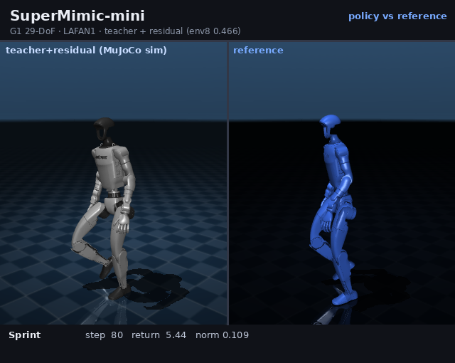

# SuperMimic-mini

An honest, small-scale attempt to reproduce the **core mechanism** of
[SuperMimic](https://arxiv.org/abs/2610.28480) (CoRL 2026) on a single
**RTX 2060 6 GB + i7-1165G7 + 15 GB RAM** machine, using MuJoCo / MuJoCo Warp / MJX
and the Unitree G1 (29 DoF).

The project is deliberately split into "what worked" and "what did not":

| Line | Result | Status |
|---|---|---|
| Teacher-assisted policy (public teacher + residual) | **env8 0.466** (teacher 0.4476) | ✅ best local result |
| Warp scaling | 1024 env, **24.7k control-steps/s** | ✅ |
| Learned world model (71-dim, 2048³, k=8) | held-out 8-step NSE **0.84–1.28** (target ≤0.05) | ❌ |
| BPTT actor-critic | raw policy **freezes or collapses** | ❌ |
| Exact-MJX control | forward/jvp works; 29-dir vmap impractically slow | ⚠️ not completed |

> **Positioning**: 0.466 is a *teacher-assisted* result on 5 trimmed LAFAN1 clips,
> not a reproduction of the paper's 0.82 on 40 full clips. The paper-scale run
> (4096 env, ~100M transitions, 2048³ WM) is out of reach on this hardware.

> **后续更新（2026-11-14）**：在 **16 GB AMD RX 6800 XT** 上把 WM 与 BPTT 重跑了一遍
> （4M transitions / 2048³ / 30k 梯度步）。原报告的「WM 动作敏感度 7.5%」被修正为
> **capture 81%**，动作梯度符号一致率 **96.2%**，BPTT 规划在真值仿真器里带来
> **+24.8%（p=1.4e-9）**。**"BPTT 不可用"的结论不再成立**——瓶颈已转移到奖励头缺 14 个
> body link 项。详见 [`docs/WM-BPTT-16GB.md`](docs/WM-BPTT-16GB.md)，代码在 [`exp/`](exp/README.md)。

## Demo

中文专栏文章（机器不学习）：https://zhuanlan.zhihu.com/p/2103496758332494680

Long version (5 clips × 400 steps, ~45 s, teacher+residual 0.466):

[](docs/demo/supermimic_ppo_demo_long.mp4)

- `docs/demo/supermimic_ppo_demo_long.mp4` (44.6 s)
- `docs/demo/supermimic_ppo_demo.mp4` (19.6 s)
- `docs/demo/supermimic_pretrained_demo.mp4` (teacher only)

## Why this repo exists

SuperMimic replaces the rigid-body simulator with a **differentiable world model**
and trains the policy by short-horizon **BPTT**. We wanted to know how much of
that survives on a 6 GB GPU. The answer is in
[`docs/FINAL-REPORT.md`](docs/FINAL-REPORT.md), including the key negative
diagnosis:

> The trained WM's action sensitivity is only **~7.5%** of the natural state
> change per step (action perturbation 1.0 → Δstate 0.041 vs natural 0.543).
> It learned "state self-evolution" from PD data and largely **ignores actions**,
> so BPTT gradients are meaningless. Adding exploration made held-out prediction
> *worse* (1.28), not better.

That is the main lesson: **a world model must be action-conditioned, not just
accurate on passive trajectories.**

> **修正（2026-11-14）**：上面这段「7.5%」是**欠训练**的产物，不是环境上限。同一诊断在
> 16 GB 卡上重做后：真值仿真器敏感度是 **34.3%**（不是 7.5%），训练到位的 WM 捕获了其中
> **81%**。原因见 [`docs/WM-BPTT-16GB.md`](docs/WM-BPTT-16GB.md) §1、§3。
> "动作条件化是 WM 的生命线"这个**直觉仍然成立**，但"7.5% 是上限"这个**结论是错的**。

## What is included

- `smini/` — env, spec (283/93/730), motion conversion, policy/critic, residual WM,
  imagination/BPTT, replay, training loop.
- `scripts/` — data pipeline, teacher adapters (JAX/MJX), PPO (MJX/Warp),
  WM71 training/eval, BPTT (CPU/Warp), MJX/JAX diagnostics, rendering.
- `docs/` — final report, paper-gap analysis, audit, WM/BPTT plans and negative
  results, MJX feasibility.
- `docs/demo/` — rendered demos (weights/data not included).

Not included: motion data, teacher checkpoints, trained checkpoints, `runs/`,
`assets/`. See [Data](#data) and [NOTICE.md](NOTICE.md).

## Install

Python ≥ 3.12. Two environments are used in the reports:

```bash
# main env: CPU MuJoCo + torch (teacher/PPO/rendering)
python -m venv .venv
. .venv/bin/activate
pip install -r requirements.txt
# CUDA 12.4 wheel for sm_75 (RTX 2060):
pip install --index-url https://download.pytorch.org/whl/cu124 torch==2.6.0

# optional Warp env (1024-env collection / BPTT)
python -m venv .venv-warp
. .venv-warp/bin/activate
pip install torch==2.6.0 --index-url https://download.pytorch.org/whl/cu124
pip install mujoco==3.16.0 mujoco-warp==3.16.0 warp-lang==1.17.0 scipy pyyaml
```

Expected workspace layout (the code resolves the G1 model as `../assets/...`
relative to the repo):

```
your_workspace/
  assets/
    mujoco_menagerie/unitree_g1/scene_mjx.xml
  supermimic-mini/        # this repo
```

Clone the G1 model:

```bash
git clone https://github.com/google-deepmind/mujoco_menagerie ../assets/mujoco_menagerie
```

## Data

LAFAN1 is **not redistributed** (CC BY-NC-ND 4.0). Download the G1 retargets from
[HuggingFace](https://huggingface.co/datasets/lvhaidong/LAFAN1_Retargeting_Dataset)
and convert:

```bash
python scripts/convert_motions.py \
  --clips walk1_subject1 run1_subject2 dance1_subject1 sprint1_subject2 jumps1_subject1 \
  --out-dir assets/motions

python scripts/trim_motions.py          # T-pose lead-in -> assets/motions_trim
```

For the 40-clip experiments, pass all clips and use `motions40` /
`scripts/trim_motions40.py` (paths are at the top of the script).

## Quick start

```bash
# unit tests
python tests/test_motion.py
python tests/test_env.py
python tests/test_learning_shapes.py

# smoke BPTT (8 env, CPU, ~1 min)
python -m smini.train --config configs/p0.yaml
```

Teacher + residual evaluation (requires `runs/pretrained/policy.pt` and
`runs/ppo_teacher5m/ckpt.pkl`; see NOTICE):

```bash
python scripts/eval_pretrained.py --steps 500
python scripts/eval_teacher_ppo_cpu.py
python scripts/render_ppo_policy_long.py   # long demo
```

WM71 training / fixed held-out eval:

```bash
# 39 train clips + 1 held-out clip; data must be in assets/motions40_trim
python scripts/train_wm71_clean.py \
  --envs 1024 --iters 1000 --updates 4 --batch 1024 \
  --motion-dir assets/motions40_trim \
  --train-clips 0,1,2,3,4,5,6,7,8,9,10,11,12,13,14,15,16,17,18,19,20,21,22,23,24,25,26,27,28,29,30,31,32,33,34,35,36,37,38 \
  --eval-clips 39
```

## Reports

| File | Content |
|---|---|
| **[docs/WM-BPTT-16GB.md](docs/WM-BPTT-16GB.md)** | **16 GB 卡重跑：WM capture 81%、梯度一致 96.2%、BPTT 规划 +24.8%；修正 7.5% 结论** |
| [docs/FINAL-REPORT.md](docs/FINAL-REPORT.md) | final report: approach, positive/negative results, root cause, gap |
| [docs/PAPER-GAP.md](docs/PAPER-GAP.md) | quantitative gap vs the paper |
| [docs/WM-UPGRADE.md](docs/WM-UPGRADE.md) | WM import/retrain attempts, action-sensitivity diagnosis |
| [docs/BPTT-STABILITY.md](docs/BPTT-STABILITY.md) | trust-region, EMA/bias bugs, freeze/collapse |
| [docs/BPTT-MINIMAL-FAIR.md](docs/BPTT-MINIMAL-FAIR.md) | 1024-env / 5M fair test |
| [docs/MJX-FEASIBILITY.md](docs/MJX-FEASIBILITY.md) | reverse-mode blocked; forward-mode cost |
| [docs/AUDIT.md](docs/AUDIT.md), [docs/REVIEW.md](docs/REVIEW.md) | data/experiment audits |

## License

Code: MIT (see [LICENSE](LICENSE)). Data, model assets, teacher checkpoints are
third-party and not included; see [NOTICE.md](NOTICE.md).

If you build on this, cite SuperMimic (arXiv:2610.28480) and link this repo.
