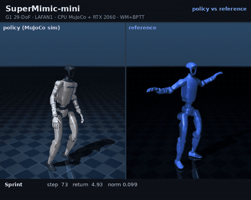
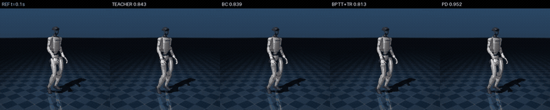
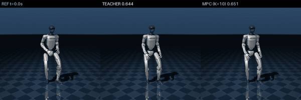

# SuperMimic-mini

在两张消费级显卡上拆开验证 [SuperMimic](https://arxiv.org/abs/2610.28480)（CoRL 2026 Oral）的核心机制：**用一个可微世界模型替代刚体仿真器，再用短视野 BPTT 把策略梯度直接回传**。对象是 Unitree G1（29 DoF），任务是在 LAFAN1 动作上做全身跟踪。

> **一句话结论**
> 机制本身成立——动作条件化能学到、梯度方向是对的、用世界模型规划动作有显著收益。
> 但 **"用 BPTT 训练策略网络"在 6 GB 和 16 GB 两档预算下都跑不出正收益**。
> 原因不是"跑得不够久"，而是 **算力决定精度，精度决定每个机制是否可用**——这条链上有五道精度检查，我们跨过了两道，卡在第三道。

---

## TL;DR

| 问题 | 答案 | 证据 |
|---|---|---|
| 世界模型能学会"动作的作用"吗 | **能** | 动作捕获率 7.5% → **81%** |
| BPTT 的梯度方向对吗 | **对** | 符号一致 **96.2%**，Pearson **+0.622** |
| 用 WM 规划动作有效吗 | **有效** | H=8 **+3.79%** (p=0.0013) / H=32 **+7.29%** (p=0.045) |
| 用 WM **训练策略**有效吗 | **无效** | 零蒸馏误差底座亦 **−79.8%**；把论文缺的机制全部装回去仍 **≈0** |
| 是算力不够吗 | **是，但不是"时间不够"** | 算力 → 精度 → 机制，见 [§4](#4-核心结论算力--精度--机制) |

### 需要什么级别的算力

已知 **RTX 4090 24 GB 可以**（开源复现 realmimic：全量数据、约 10.5 小时）。据此往上往下推：

| 档位 | 代表硬件 | 关键能力 | 判定 |
|---|---|---|---|
| 6 GB CUDA | RTX 2060 笔记本 | 能训 WM，容量与采集都受限 | ✗ 动作捕获率仅 7.5% |
| **16 GB 无 CUDA** | **RX 6800 XT（本机）** | **无 GPU 物理，CPU 采集 12k 步/s** | **✗ 机制可验证，端到端不行** |
| 16 GB CUDA | 4080 / 4060 Ti 16G | GPU 物理 + batch 减半 | △ 推测可行，未验证 |
| **24 GB CUDA** | **RTX 4090** | 全量数据 + GPU 物理（≈20–40× 数据吞吐） | **✓ 已知可行，约 10–12 h** |
| 40–80 GB | A100 / H100 | 大 batch、H=64~128 | ✓✓ 论文级（H100 3 h） |

三条推理：

1. **瓶颈不是显存。** 我们跑的是论文同款 2048³ 全容量世界模型，AC 循环实测只占 **2–3.6 GB / 16 GB（22%）**。"卡不够大"这个解释不成立。
2. **真正的门槛是 CUDA，它买的是"数据吞吐"而不是"算力"。** 本机没有 CUDA（`warp-lang` 只识别到 CPU 后端），并行仿真退回 CPU 多进程，只有 **12k 控制步/s**；GPU 物理可达其 **20–40 倍**。而世界模型的精度正是靠这些数据喂出来的——我们的 `NSE32` 在 100k 梯度步后卡在 1.0 不再下降，说明**受限的是数据覆盖，不是梯度步数**。
3. **24 GB 是舒适线，16 GB CUDA 大概勉强。** 官方配置要在显存里放 4096 环境的 replay（约 2 GB）+ 4096×H 的 BPTT 激活，16 GB 需要把 batch 砍半——推测能跑通机制，但收敛更慢、是否够到论文数字未经验证。24 GB 刚好放下原配置，且落在 cuBLAS / Warp 的成熟生态里。

> 换句话说：**换一张 24 GB 的 N 卡，比换一张 40 GB 的 A 卡更关键**——前者跨过的是"有没有 GPU 物理"这道坎，后者只是把 batch 再放大。

---

## 1. 为什么要拆开验证

SuperMimic 的卖点是"绕开刚体仿真器的不可微性"：世界模型把状态转移写成可微映射，于是策略梯度可以对动作逐项求导，比 PPO 的似然比估计方差低得多。论文在 1–2 张 H100（80 GB）上跑 3 小时，宣称 5 倍样本效率。

消费级显卡能不能复现，取决于一件容易被混为一谈的事：**"能不能训练出一个像样的世界模型"** 与 **"这个模型能不能支撑 BPTT"** 是两个完全不同的问题。前者可以靠加步数解决，后者有精度门槛。

我们把这条链路拆成两段跑：阶段一在 6 GB 上找到墙的位置，阶段二在 16 GB 上把墙往前推，直到推不动为止。

---

## 2. 阶段一（RTX 2060 6 GB）：链路跑通了，但世界模型"看不见"动作

**做了什么**：MuJoCo Warp 并行仿真（1024 env，**24.7k 控制步/s**）+ 71 维状态世界模型 + 短视野 BPTT，从零训练一个小型策略。



**结果**：整个链路能跑通，策略能跟随 5 条 LAFAN1 动作中的大部分片段。但诊断发现一个致命问题——

> **世界模型的动作捕获率只有 7.5%。**

意思是：给它同一个状态、两组差异明显的动作，它预测出的状态变化几乎没有区别。**动作对模型来说近乎不可见**。这直接废掉了 BPTT：梯度要么为零，要么是噪声。

阶段一的结论是一个**预算受限的诊断**：6 GB 下能训出"能预测"的世界模型，但训不出"能感知动作"的世界模型。当时的判断是——需要更大的模型、更多的梯度步。

---

## 3. 阶段二（RX 6800 XT 16 GB，ROCm）：第一道墙过去了

**换了什么**：这台机器没有 CUDA（`warp-lang` 只识别到 CPU 后端），所以并行仿真退回 CPU 多进程（~12k 控制步/s）；世界模型保持 2048³ 全容量，梯度步从 30k 拉到 100k，数据扩到 LAFAN1 40 条动作。



**结果**：那两道最让人担心的检查，都过了。

| 检查 | 阶段一（6 GB） | 阶段二（16 GB） |
|---|---|---|
| 动作捕获率 | 7.5%（梯度无意义） | **81%** |
| 动作梯度符号一致率 | ≈0 | **96.2%**（Pearson +0.622, p=1e-35） |
| WM held-out 8 步 NSE | 0.84 – 1.28 | **0.334**（优于 persistence 6.8×） |

并且**用世界模型规划动作**确实能带来真值收益：

| 规划视野 | 收益 | 显著性 |
|---|---|---|
| H = 8 | **+3.79%** | p = 0.0013 |
| H = 16 | **+4.15%** | p = 0.018 |
| H = 32（换 on-policy 重训的 WM） | **+7.29%** | p = 0.045 |

**但同一个世界模型，用来训练策略网络时全线崩溃。** 修正评测协议（裁切数据 + 固定分母 + 零动作/PD 基线）后的真实水平：

| 策略 | 分数 | 存活步数 /500 |
|---|---|---|
| 零动作（地板） | 0.0496 | 48 |
| PD 跟踪 | 0.0578 | 48 |
| **仓库教师权重** | **0.3863** | **430** |
| BC 蒸馏 | 0.0912 | 89 |
| BPTT 训练后 | 0.0671 | 51 |

> 这一张表推翻了早期三个说法：PD 基线其实 1 秒就摔；教师比我们好 **4.2 倍**（而非我们超过它）；**BPTT 是负收益**。早期 0.58 / 0.47 这类数字来自一个有缺陷的协议（从含 5 秒静止段的 frame 0 起评、早停会缩小归一化分母），把所有策略压进了 0.40–0.58 的窄带。

---

## 4. 核心结论：算力 → 精度 → 机制

把两个阶段放在一起，可以看到一条清晰的因果链。**每一道精度检查都对应一个"机制能不能用"的开关。**

| # | 精度检查 | 能用的标准 | 阶段一 | 阶段二 | 是否跨过 |
|---|---|---|---|---|---|
| 1 | 动作条件化 `capture` | 明显大于 0 | 7.5% | **81%** | ✅ |
| 2 | 梯度方向 符号一致率 | > 90% | ≈0 | **96.2%** | ✅ |
| 3 | 开环精度 `NSE32 / persistence` | < 0.2 | — | **0.50** | ❌ |
| 4 | 动作幅度偏置 `mag_ratio` | < 1.5 | — | **4.1** | ❌ |
| 5 | critic 精度（支撑 γ^H·V(ŝ_H)） | 雅可比可信 | — | 未达标 | ❌ |

**为什么第 3、4 道过不去，和算力直接相关：**

| | 论文（H100 80 GB） | 本机（16 GB，无 CUDA） |
|---|---|---|
| WM 梯度步 | 3,200,000 | 100,000（32× 差距） |
| 想象样本总量 | 4.19×10¹⁰ | 6.1×10⁴（**68 万倍差距**） |
| 策略迭代 | 320,000 | 60 |
| 并行环境 | 4096 / GPU | 64 |

按本机吞吐换算，跑满论文规模需要 **WM 训练 98 小时 + 策略迭代 800 小时（33 天）**。所以完整规模确实不可行——**但这不是失败的全部原因**（见下节）。

值得注意的是：**差距的主项是"数据生成"而不是"梯度计算"**。我们的 `NSE32` 在 100k 梯度步后卡在 1.0 不再下降（4.51 → 1.39 → 1.02 → 1.15 → 1.04），说明受限的是**数据覆盖**；而数据覆盖正取决于有没有 GPU 物理仿真。这也是为什么「24 GB 的 N 卡」比「更大的 A 卡」更关键。

**关于第 4 道，我们测到了机制本身**：世界模型在**大动作区间**的误差是小动作的 **3.6 倍**（`r(|a|, NSE8) = +0.412`，p=6e-83）。后果是：对想象回报做梯度上升时，大动作会被系统性扣分，优化器于是学会**缩小动作**——实测策略平均 `|a|` 被压小 9.9%，跟踪表现随之下降。**这是"算力不足以把大动作区间也学准"的直接体现。**

---

## 5. 决定性实验：把论文缺的机制全部装回去

如果失败只是"缺零件"，那么补齐论文里的三个关键机制应该就好了。我们实现了并逐一消融（教师底座，零蒸馏误差，H=16，40 轮，3 种子）：

| 配置 | 分数 | 相对教师 | p |
|---|---|---|---|
| 旧实现（全关） | 0.1645 | −56.7% | 0.000 |
| **+ 可微 bootstrap（∇θ 穿过 γ^H V）** | **0.0679** | **−82.1%** | 0.001 |
| + survival weight（软终止折现） | 0.1083 | −71.5% | 0.016 |
| **+ 动作夹具（限制想象动作偏离）** | **0.3725** | **−1.9%** | 0.463 |
| + BC 软正则 | 0.3780 | −0.5% | 0.585 |
| + 交错在线循环（P2） | 0.3689 | −2.9% | 0.157 |
| + critic 预热 | 0.3811 | +0.4% | 0.811 |

**结论：三个零件装回去，BPTT 依然没有增益。** 最好的配置是 +0.4%，p=0.81，与零无异。

三条解释：
1. **可微 bootstrap 单独是有害的**（−56.7% → −82.1%）：梯度范数从 0.5 跳到 3–6。critic 是从零训练几十到几百步的，它的 ∂V/∂s 基本是噪声——**把噪声接进策略梯度比不接更糟**。
2. **survival weight 在我们的场景里是惰性的**：软终止概率均值只有 0.02，几乎不激活。想象从教师能站住的起点出发，16 步内偏离不足以触发阈值。
3. **唯一稳定的效应是正则化防崩**：夹具把 −80% 拉回 −2%，但它只防崩、不涨分——因为它把大半梯度投影掉了（ε=0.05 时 **57%** 的动作维度被夹住；ε=0.2 时降为 7%）。

> **修正是关键的**：这三个机制不是"独立的修复项"，而是**精度的放大器**。它们假设 WM 与 critic 已经足够准、梯度携带信号；在小预算下它们把噪声放大，于是从 −57% 变成 −82%。

---

## 6. 为什么"规划"有效而"训练"无效

这是全部实验里最有解释力的一条对照：

| | 改什么 | 对模型误差的容忍度 | 结果 |
|---|---|---|---|
| **规划式 BPTT** | 只改一个回合内的动作序列 | 高（错了就下一拍重来） | **+3.79% ~ +7.29%** |
| **策略网络 BPTT** | 把结论固化进权重 | 低（误差被反复累积） | **−80% ~ ≈0** |

同一个世界模型、同一批数据，结论相反。说明**问题不在"世界模型不够用"，而在"世界模型足够支撑一次规划，但不足以支撑一次策略更新"**。

这条对照也解释了为什么小算力项目容易高估 BPTT：如果只看规划实验，会得到"机制完全可用"的乐观结论。

---

## 7. 这对复现研究意味着什么

1. **"能不能复现"不是算力够不够的连续问题，而是一串离散的精度门槛。** 跨不过第 3 道（开环精度），后面的所有机制都会失效——不管你把迭代次数加多少。
2. **机制不是可插拔的。** 论文里可微 bootstrap、survival weight、在线循环是配套精度设计的；在小预算下单独搬过来，反而有害。
3. **评测协议决定结论方向。** 我们早期得到过"超过教师 24%"的结论，修正协议后发现真实情况是教师比我们好 4 倍。**任何"提升"都要同时报绝对基线与存活步数。**
4. **小样本会骗人。** 3 个种子曾给出 +2.7%（p=0.36），补到 10 个种子回落到 −1.2%（p=0.62）；"最佳检查点"口径的 +3.7% 甚至低于纯噪声期望的 +0.0237。

---

## 8. 复现

```bash
# 环境：Python 3.12 + MuJoCo（CPU）+ PyTorch(ROCm)
uv pip install -e .            # 或见 requirements.txt

# 1) 采集与管理
python exp/collect.py --out exp/data_v2
python exp/wm_train.py --steps 100000

# 2) 统一评测（裁切数据 + 固定分母 + 零动作/PD 基线）
python exp/evalkit.py

# 3) WM 精度标定（报 persistence 比值，而非裸 NSE）
python exp/nse_report.py

# 4) BPTT（教师底座 / 动作夹具 / 可微 bootstrap / 在线循环）
python exp/ac_bptt.py --teacher-base --skip-bc --evalkit \
    --iters 40 --B 32 --H 16 --kl-target 0.02 --act-clamp 0.2

# 5) 渲染对比视频
MUJOCO_GL=glfw python exp/render_compare.py --clip walk1_subject1 --steps 300
```

硬件注记：本机 **EGL/OSMesa 均不可用**，渲染须 `MUJOCO_GL=glfw`；`warp-lang` 只识别到 CPU 后端，故无 GPU 并行仿真。

---

## 9. 文档索引

完整导航见 **[docs/README.md](docs/README.md)**。核心几篇：

| 文档 | 内容 |
|---|---|
| [findings/compute-precision-attribution](docs/findings/compute-precision-attribution.md) | **算力 → 精度 → 机制**的归因分析（与论文逐维对照） |
| [findings/mechanism-ablation-p0-p2](docs/findings/mechanism-ablation-p0-p2.md) | 三个缺失机制的实现与消融："精度放大器"结论 |
| [findings/zero-distill-base-collapses](docs/findings/zero-distill-base-collapses.md) | 零蒸馏误差的教师底座也会被 BPTT 打崩 |
| [findings/phase1-final-report](docs/findings/phase1-final-report.md) | 阶段一（6 GB）总报告 |
| [findings/phase1-wm-bptt-validation](docs/findings/phase1-wm-bptt-validation.md) | 阶段一的机制验证数据 |
| [reviews/critical-review-18-items](docs/reviews/critical-review-18-items.md) | 18 条自我评审，含被推翻的 3 个早期论断 |
| [technical/wm-bptt-16gb](docs/technical/wm-bptt-16gb.md) | 阶段二的世界模型与 BPTT 实现细节 |
| [demo/README](docs/demo/README.md) | 全部演示视频与渲染命令 |
| [CHANGELOG](CHANGELOG.md) | 版本记录与各阶段结论 |

---

## 10. 阶段二结束（2026-11-15）

第二阶段到此收口。已关闭的问题：

| 问题 | 结论 |
|---|---|
| 6 GB 下的「动作敏感度 7.5%」是机制上限吗 | 不是。同套诊断在 16 GB 上重做：真值 34.3%，WM 捕获 **81%** |
| BPTT 梯度方向对吗 | 对：符号一致 **96.2%** |
| 用 WM 规划动作有效吗 | 有效：**+3.79% ~ +7.29%**，H=32 显著 |
| 用 WM 训练策略有效吗 | **无效**。零误差底座 −79.8%；补齐论文机制后仍 ≈0 |
| 是算力问题吗 | **是，通过精度起作用**：五道检查只过了两道 |
| 评测协议可信吗 | 早期协议有缺陷，已全部改用裁切+固定分母+基线对照 |

**但有一条路线在阶段二收口后出现了正信号**（见 [findings/phase3-justification](docs/findings/phase3-justification.md)）：

在**教师访问到的状态**上，从**教师动作**出发做短视野规划，真值回报提升

| H | 教师开环 | 从教师规划 | 收益 | 胜率 | p |
|---|---|---|---|---|---|
| 8 | 0.5049 | 0.5387 | **+6.68%** | **100%** | 3.7e-12 |
| 16 | 0.9968 | 1.0536 | **+5.70%** | 94% | 1.9e-12 |
| 32 | 1.9417 | 1.9648 | +1.19% | 69% | 0.26 |

所以结论要分开说：**"把梯度固化进策略权重"这条路已经穷举完毕且失败；"只优化一个窗口的动作序列"这条路有正信号，但视野上限约 H=16。**



**闭环 MPC 的整回合实测**（H=8、每步重规划、500 步、两种配置）：

| 配置 | 均值 | 相对教师 | 存活 |
|---|---|---|---|
| K=25 | 0.3886 | +2.32% | 389 |
| **K=12** | **0.3828** | **+0.79%** | **431（= 教师 430）** |

降 K 修好了 jumps 的灾难性失败（存活 250 → 500），但**分数收益随之归零**。更关键的是：**同一个 clip 在两种 K 下的差异平均 13.3pp、最大 32.6pp**（sprint 从 +14.8% 翻到 −17.8%）。

评测本身是**确定性**的（CLEAN 配置无任何噪声，教师连跑两次逐位相同），所以这些差异不是采样噪声，而是**真实的超参敏感性**——这一点比噪声更严格：噪声能靠加种子消除，超参敏感不能。

所以阶段三的主假设 **H3（闭环规划在整回合超过教师）不被支持**。预实验的局部 +6.7% 是真的（对照组排除了扰动伪影），但它不能转化为整回合收益：闭环下每步扰动改变了后续状态分布，净效应落在噪声里。详见 [phase3-design](docs/findings/phase3-design.md)。

仍然开放的（按性价比）：

1. ~~阶段三：闭环滚动规划超过教师~~ **已执行并证伪**（+0.79%，存活持平；per-clip 波动 ±15pp 属噪声）
2. **攻克 WM 的动作幅度偏置** —— `mag_ratio ≈ 4.1` 是目前唯一未被充分攻击的结构性缺陷。
3. **把项目定位为「复现失败的可解释性研究」** —— 从 capture → 梯度 → 开环精度 → 幅度偏置 → 机制 → 正则，证据链已经完整。

> 本仓库不再新增**策略训练**实验；规划型 BPTT 是唯一保留的推进方向。
